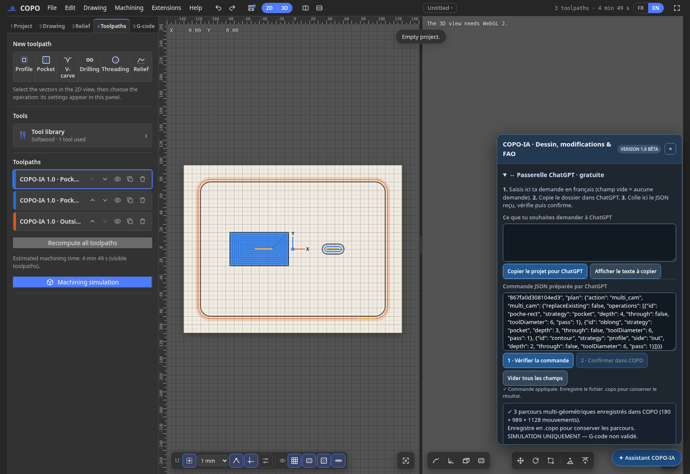

# COPO-IA 1.0 bêta — passerelle ChatGPT ↔ COPO

**Extension expérimentale et non officielle** de [COPO](https://github.com/gbulleryahen-hash/copo), logiciel libre de CAO/FAO développé par **gbulleryahen-hash**. Licence **GNU GPL v3** (voir [`LICENSE`](LICENSE)).

COPO-IA permet de décrire des formes et des opérations d’usinage en français dans ChatGPT, puis de transmettre un **plan JSON vérifié** au logiciel COPO. Les échanges se font **manuellement par copier-coller**, sans clé API payante ni compte supplémentaire pour la passerelle. Une vérification et une confirmation distinctes précèdent toute modification du projet.

> **BÊTA / SIMULATION UNIQUEMENT.** Les parcours générés par cette extension ne sont pas qualifiés pour un usinage réel. Ils ne doivent pas être exécutés sur une machine CNC sans validation technique indépendante des géométries, outils, avances, vitesses, origines, dégagements, bridages et postprocesseurs.

## Télécharger et essayer

Pour bénéficier de **tous** les fichiers, notamment la bibliothèque de dessins et de reliefs de COPO, utiliser l’**archive complète** associée à la publication GitHub « `v1.0.0-beta` » dans [Releases](https://github.com/jmbarbecontact/COPO-IA/releases). **Le dépôt de code ne contient volontairement pas les 570 ressources volumineuses de `bibliotheque/`.** Il sert à examiner les sources et l’historique ; pour un essai complet, privilégier l’archive de la publication.

1. Télécharger l’archive complète de la release, puis décompresser son dossier.
2. Ouvrir `index.html` avec Google Chrome.
3. Ouvrir **Assistant COPO-IA → Passerelle ChatGPT**.
4. Charger `Exemple-multiformes-COPO-IA-1.0.copo` via **Ouvrir .copo**.
5. Dans COPO, saisir sa demande en français, puis **Copier le projet pour ChatGPT**.
6. Coller cet état dans une conversation ChatGPT ; récupérer la réponse JSON, puis la coller dans **Commande JSON préparée par ChatGPT**.
7. Cliquer successivement sur **1 · Vérifier la commande** puis, après lecture du rapport, **2 · Confirmer dans COPO**.
8. Contrôler les trajectoires dans la simulation et sauvegarder le projet en `.copo`.

**Aucun transfert automatique** n’existe entre ChatGPT et le navigateur local. Les commandes comprennent une signature de projet et sont refusées si l’état du projet a changé.

## Fonctionnalités expérimentales

| Famille | Possibilités |
| --- | --- |
| Géométrie libre | Rectangle, rectangle à coins arrondis, cercle, oblong, polygone, répétition circulaire de perçages |
| Édition | Ajout, modification et suppression d’une forme par identifiant stable |
| FAO circulaire 0.9 | Poches circulaires borgnes identifiées individuellement |
| **FAO multi-géométrique 1.0** | Poches rectangulaires/arrondies/oblongues/circulaires ; profils extérieurs non traversants sur contours compatibles |
| Flux de travail | Contrôle de la signature, des paramètres géométriques et de l’outil ; confirmation ; simulation ; conservation dans `.copo` |

Les opérations automatiques 1.0 demandent **explicitement** une profondeur, une fraise présente dans la bibliothèque et une profondeur de passe. Les profils extérieurs traversants et le bridage des pièces détachées ne sont pas pris en charge par la passerelle. Les fonctions natives de COPO ne sont pas remplacées.

## Essais de la version 1.0

**Tests automatisés** dans Chromium avec le moteur natif COPO :

- Poche rectangulaire 70 × 40 mm, profondeur 4 mm, fraise Ø6 mm, passes 1 mm : **180 mouvements**.
- Poche oblongue 26 × 12 mm, profondeur 3 mm : **989 mouvements**.
- Profil extérieur R12, profondeur 2 mm : **1 128 mouvements**.
- Trois parcours créés, enregistrés puis retrouvés à la réouverture.
- Contrôles de refus : mauvais outil, profondeur traversante, marge insuffisante, commande périmée, remplacement incomplet.
- Conservation des fonctions de la 0.9 et de la FAO historique.

**Validation utilisateur sur Mac (22 novembre 2026)** : affichage des trois géométries, création des trois parcours depuis une seule commande ChatGPT, simulation 3D menée à terme et sauvegarde/réouverture réussies. Il s’agit de **tests logiciels**, sans qualification industrielle ni essai CNC réel.

Voir [`TESTS-COPO-IA-1.0.txt`](TESTS-COPO-IA-1.0.txt), [`VALIDATION-MAC.md`](VALIDATION-MAC.md) et [`CHANGELOG.md`](CHANGELOG.md).

## Architecture

- `index.html` : logiciel COPO avec extension intégrée ;
- `copo-passerelle.js` : copie de l’état du projet et import des plans JSON ;
- `copo-dialogue.js` : validation et confirmation ;
- `copo-features.js` : formes libres et identifiants persistants ;
- `copo-fao-libre.js` : FAO circulaire ;
- `copo-fao-multiformes.js` : FAO multi-géométrique ;
- `copo-ia.js` / `copo-fao.js` : fonctionnalités historiques.

Protocole : `COPO_CHATGPT_PROJECT_V1` → `COPO_CHATGPT_PLAN_V1`, avec empreinte de projet et validation des paramètres. La passerelle **n’autorise pas l’exécution de JavaScript** provenant d’une conversation.

## Origine, attribution et ressources

- **Projet original** : [gbulleryahen-hash/copo](https://github.com/gbulleryahen-hash/copo), copyright © 2026 g.bulleryahen.
- **COPO-IA** : modification expérimentale indépendante, publiée par [jmbarbecontact](https://github.com/jmbarbecontact/COPO-IA), sans affiliation ni approbation revendiquées du projet original.
- **Licence de la modification logicielle** : GNU GPL v3, texte complet dans `LICENSE` ; `README-COPO-ORIGINAL.md` conservé pour référence.
- **Bibliothèque de dessins/reliefs** : sa provenance et les licences des ressources individuelles figurent dans `bibliotheque/CREDITS.md`, présent dans l’archive complète.
- **Polices optionnelles** : certains fichiers de polices décoratives ne sont pas redistribués avec ce paquet ; certaines fonctions typographiques avancées peuvent nécessiter des ressources supplémentaires.

Ce projet documente une expérience de développement assisté par IA. Il ne constitue ni une garantie de qualité industrielle ni un outil de pilotage CNC validé.
